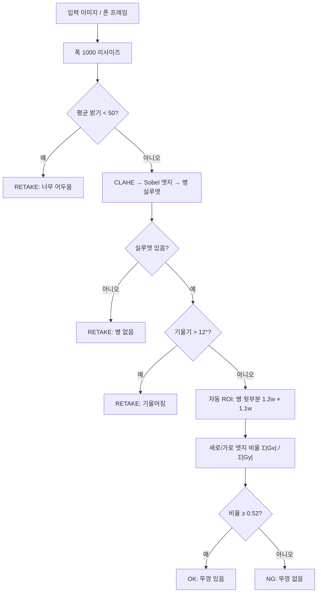
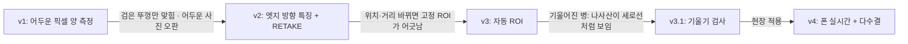

# 병뚜껑 유무 검사 (OpenCV 규칙 기반) — v1 → v4

> 수업 방식(v1)으로 시작해 **직접 문제를 찾고 v2 · v3 · v3.1로 개선**한 뒤, 폰 카메라로 **실시간 OK / NG** 판정(v4)까지 만든 미니 프로젝트입니다.

## 한눈에 보기
| 버전 | 핵심 변경 | 새 사진 성능 | 뚜껑 없는데 통과 (위험) |
|---|---|---|---|
| v1 (수업) | Otsu 이진화 → 면적 비율 ≥ 0.3608 | holdout 5/8 (62.5%) | 3건 |
| v2 | 어두우면 RETAKE + **세로/가로 엣지 비율** (색과 무관) | holdout 5/8 (62.5%) | **0건** |
| v3 | **자동 ROI** (병 실루엣 기준) | **final 9/10 (90%)** | 1건 (기울어진 병) |
| v3.1 | **기울기 > 12° → RETAKE** | final 판정 7/7 · RETAKE 3 *(참고용)* | 0건 |
| v4 | v3.1 규칙을 모듈로 분리 → 폰 실시간 + 15프레임 다수결 | 구현 완료 · 실시간 시연 예정 | — |

- 각 버전의 성능은 **그 버전이 기준값을 정할 때 보지 않은 사진**으로만 보고합니다.
- 위험한 오류 = **뚜껑이 없는데 OK**(불량 통과). 이 숫자를 줄이는 것을 우선으로 했습니다.

## 판정 흐름 (v3.1 / v4)


v4(실시간)에서는 위 판정을 프레임마다 하고, **최근 15프레임 중 10프레임 이상 같은 판정**일 때만 화면에 최종 결과를 띄웁니다.

## 버전별로 찾은 문제 → 개선


1. **v1 → v2:** v1은 '어두운 픽셀 양'을 재서 검은 뚜껑만 맞혔습니다 (test 검은 8/8 · 흰 2/4 · 없음 3/12). → 뚜껑 옆 **줄무늬 = 세로선**, 병 **나사산 = 가로선**이라는 점을 이용해 색과 상관없는 특징으로 바꿨습니다.
2. **v2 → v3:** 촬영 위치가 바뀌자 고정 ROI에 병 목이 섞여 정상을 불량으로 판정했습니다. → 병 실루엣을 찾아 ROI를 자동으로 맞췄습니다.
3. **v3 → v3.1:** final의 유일한 실패는 30° 기울어진 병이었습니다. 나사산이 대각선이 되어 세로선으로 계산됐습니다. → 기울어진 병은 판정하지 않고 RETAKE로 처리합니다.
4. **v3.1 → v4:** 규칙을 `cap_core.py`로 분리하고, 폰 영상의 흔들림은 다수결로 보정했습니다.

## 데이터
| 세트 | 장수 | 용도 |
|---|---|---|
| test | 24 | v1 분석, v2 기준값 결정 |
| holdout | 8 | v2 검증 → v3 Calibration에 포함 |
| final | 10 | v3 최종 검증 (위치·거리·각도를 일부러 다르게 찍음) |

파일 이름이 곧 정답입니다: `cap_{on|off}_{색}_{조명}_NN.png`

## 폴더 구조
```
cap_test/
├─ data/{test, holdout, final}/
├─ src/
│  ├─ 00_roi_grid.py      # ROI 위치 확인용 격자
│  ├─ 01_roi_crop.py      # 고정 ROI 자르기
│  ├─ 02_baseline.py      # v1
│  ├─ 03_v2_features.py   # 특징값 확인
│  ├─ 04_v2_inspect.py    # v2
│  ├─ 06_auto_roi.py      # 자동 ROI + 기울기
│  ├─ 07_v3_inspect.py    # v3 / v3.1
│  ├─ cap_core.py         # v3.1 판정 규칙 모듈
│  └─ 08_live.py          # v4 실시간
├─ reports/               # 버전별 CSV, 비교 보고서
└─ docs/                  # 포트폴리오 SVG 4장
```

## 실행
```bash
python -m venv .venv && source .venv/bin/activate
pip install opencv-python numpy

cd src
python 02_baseline.py holdout        # v1
python 07_v3_inspect.py final        # v3 / v3.1
python 08_live.py                    # v4 (URL을 폰 IP Webcam 주소로 수정)
```
실시간 키: `1` 실제 있음 기록 · `2` 실제 없음 기록 · `s` 화면 저장 · `q` 종료

## 포트폴리오
[1 표지](docs/cap2_p1_cover.svg) · [2 개선 과정](docs/cap2_p2_journey.svg) · [3 방법과 결과](docs/cap2_p3_method.svg) · [4 실시간과 배운 점](docs/cap2_p4_live.svg)

## 한계와 다음 단계
- **너무 가깝게 찍어 뚜껑이 화면 양끝에 닿으면** 폭·기울기를 제대로 못 잽니다 → "너무 가까움" 검사가 필요합니다.
- 기울기 보정(이미지 회전)은 아직 없고, 지금은 RETAKE로 처리합니다.
- 데이터가 42장으로 적고 원본 해상도가 낮습니다.
- v4 실시간 시연(정답 로그 20회: 있음 10 · 없음 10)은 아직 진행 전입니다. WSL에서 창이 뜨지 않는 문제(headless OpenCV)를 해결한 뒤 기록할 예정입니다.
